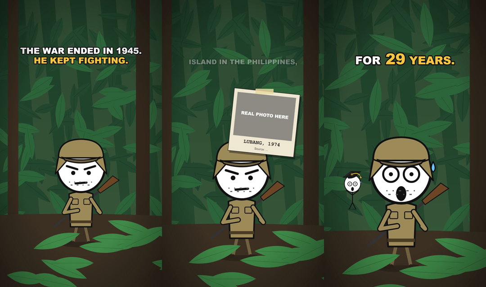
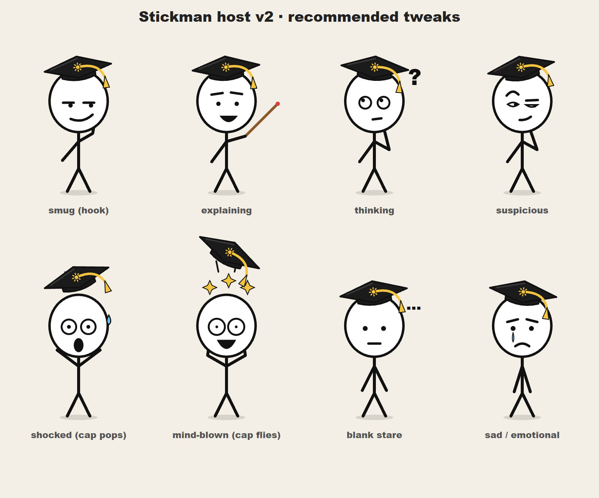
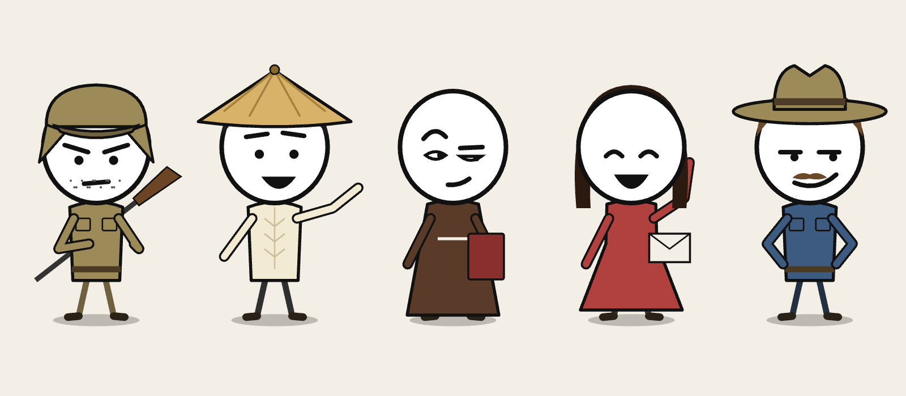
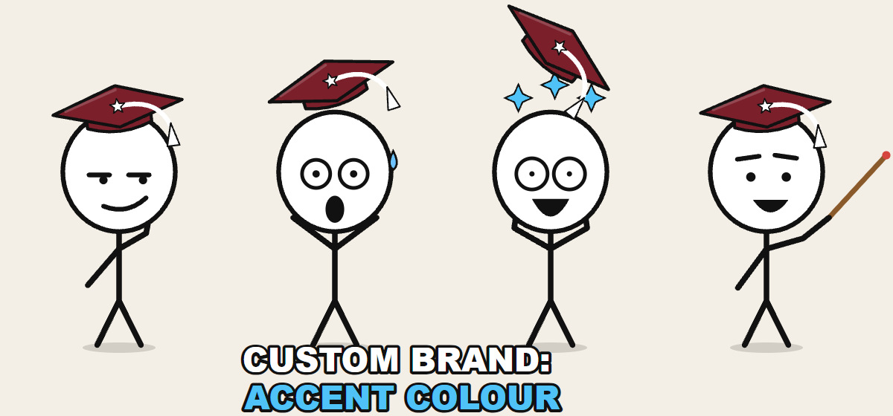

# 🎓 Antiks Stories — Claude Skill

**Make 1-minute cartoon story videos about the Philippines, with Claude doing the work.**

You tell Claude a story idea. Claude researches it, writes the script, records the narration, animates the cartoon, adds sound effects and gives you a finished video ready for **YouTube Shorts, TikTok, Facebook Reels and Instagram Reels**.

> *Antiks Stories — "Old stories. New antics."*



---

## ✨ What you get

| | |
|---|---|
| 🎬 **Finished video** | Vertical 1080x1920, 62–75 seconds (long enough to earn on TikTok) |
| 🎙️ **Natural narration** | Free AI voice (Kokoro, British male "George") read line by line with dramatic pauses |
| 🧑‍🎓 **Your own host** | A meme-style stickman with a graduation cap who reacts to the story — his cap flies off when he's shocked |
| 🎨 **Cartoon + real history** | Simple doodle characters in era costumes, plus real old photos that prove the story is true |
| 🔊 **Sound effects** | Impacts, whooshes, risers, heartbeats… all synced to the narration. No music = no copyright problems |
| 💬 **Captions** | Big animated captions with key words in gold — works even with the sound off |
| ✅ **Safety checks** | Length, loudness, text position, sources and licences are checked before you post |
| 📝 **Posting text** | Titles, captions, hashtags and a pinned comment for each platform |

**Cost:** free (you only need a paid Claude plan — Pro is enough).

<p align="center"></p>
<p align="center"></p>

---

## 🛠️ Setup guide (one time, about 30 minutes)

### Step 1 — What you need
- A **Windows 10/11** computer with internet (Windows only for now — the setup and renderer use PowerShell and Microsoft Edge). 6 GB RAM works; 8 GB+ is more comfortable.
- A **paid Claude plan** (Pro, Max, Team or Enterprise).
- **Claude Code** — either the VS Code extension (search "Claude Code" in VS Code Extensions) or the terminal version:
  ```powershell
  irm https://claude.ai/install.ps1 | iex
  ```
- **Microsoft Edge** (already on Windows).

### Step 2 — Download this skill
On this repo's GitHub page, click the green **Code** button → **Download ZIP**, and unzip it anywhere (for example your Downloads folder).
Or, if you use git:
```powershell
git clone https://github.com/BhosxzTechke/antiks-stories.git
```

### Step 3 — Run the setup script
1. Open the unzipped folder (it contains `SKILL.md`, `scripts`, `assets`…).
2. Click the address bar of File Explorer, type `powershell` and press Enter. A PowerShell window opens **in that folder**.
3. Paste this and press Enter:

```powershell
powershell -ExecutionPolicy Bypass -File .\scripts\setup.ps1 -Project "C:\Videos\Antiks" -Install
```

What each part means:

| Part | Meaning |
|---|---|
| `-ExecutionPolicy Bypass` | Windows blocks downloaded scripts by default. This allows **only this script, only this time** — your settings are not changed. |
| `-File .\scripts\setup.ps1` | The setup script in this folder. |
| `-Project "C:\Videos\Antiks"` | **Where your videos will live.** Change it to any folder you like — it's created if it doesn't exist. |
| `-Install` | If a program is missing (Node.js, FFmpeg, Python 3.12, eSpeak NG), install it for you. **Click "Yes"** if Windows asks for permission. Leave it out to only check. |

The script then:
1. ✅ Checks all programs
2. 📁 Copies this skill into your project (`.claude\skills\antiks-stories`)
3. 🖼️ Installs the video renderer
4. 🎙️ Installs the Kokoro voice (about 1 GB download — be patient)
5. 🔊 Creates the sound-effects kit and a `videos` folder
6. 🧪 Tests the voice

When you see **"Setup complete"**, you're done.

### Step 4 — Make it yours 🎨 (important)
This skill comes with the **Antiks Stories** brand. That name and its host design belong to the Antiks Stories channel, so **set up your own brand before posting**.

Open this file **in your project** with Notepad or VS Code:
`<your project>\.claude\skills\antiks-stories\data\brand.json`

```json
{
  "name": "Your Channel Name",
  "tagline": "Your short tagline.",
  "handle": "@yourhandle",
  "narrator_voice": "bm_george",
  "colors": { "accent": "#4fc3f7", "ink": "#111111", "paper": "#efe6d2" },
  "host": { "cap_color": "#7b1f2a", "tassel_color": "#ffffff", "badge": "star", "badge_color": "#ffffff" }
}
```

| Setting | What it changes |
|---|---|
| `name`, `tagline`, `handle` | Your channel name and tagline. Used in endings and posting text. |
| `narrator_voice` | Kokoro voice, e.g. `bm_george`, `bm_fable`, `am_michael`, `af_heart` |
| `colors.accent` | Colour of key words in captions, big numbers and sparkles |
| `host.cap_color` / `tassel_color` | Your host's graduation cap and tassel colours |
| `host.badge` | The badge on the cap: `sun`, `star`, `heart`, `dot` or `none` |

Example with a custom brand:

<p align="center"></p>

> Want a completely different host or topic (not the Philippines)? You can. The rules Claude follows are plain text files in `reference/`, and the drawings are in `assets/lib/antiks.js`. Ask Claude: *"Change the antiks-stories skill to make stories about Japan with a cat host."*

> 💡 If it says a program was just installed and a command is "not recognized": **close PowerShell, open a new one, and run the same command again.** It skips what's already done.

---

## 🚀 How to use it

### 1. Open your project folder
- **VS Code:** File → Open Folder → your project folder (e.g. `C:\Videos\Antiks`) → click the Claude icon.
- **Terminal:** `cd C:\Videos\Antiks` then `claude`

Always start a **new chat** after setup so Claude loads the skill.

### 2. Type the command

```
/antiks-stories
```
Claude asks one question: *do you have a story topic, or should it find one?*

Or give the topic directly:
```
/antiks-stories The Battle of Mactan and Lapu-Lapu
```

You can also just talk normally: *"Make the next Antiks video about Hiroo Onoda"* or *"Run the Antiks story finder"*.

### 3. Approve 3 times ✋
Claude stops and waits for you at three points:

| Checkpoint | What you check | Your job |
|---|---|---|
| **1. Story** | The facts + sources, real photos, **3 hook ideas** | Pick a hook (or ask for changes) |
| **2. Script** | The script, the scene plan, and `names-preview.wav` | Listen: are Filipino names said correctly? |
| **3. Preview** | A quick low-quality `preview.mp4` | Say what to change, in plain words, one thing at a time |

Then Claude makes the final video and runs the safety checks.

### 4. Post it
Your video folder (e.g. `videos\01-onoda\`) now has:
- `out\final.mp4` → **upload this same file** to all 4 platforms
- `out\publish.md` → copy the title, caption and hashtags for each platform

### 5. Tell Claude how it did
After a few days, give Claude your numbers (YouTube Studio: *viewed vs. swiped away*, average % viewed). It logs them and uses them to choose better hooks next time.

---

## 💬 Useful things to say

| You want to… | Say |
|---|---|
| Get story ideas | "Run the Antiks story finder" |
| Continue tomorrow | "Continue my Antiks video" (terminal: `claude --continue`) |
| Change something | "Make the cold open faster" · "Bigger captions" · "Less shaking" |
| Fix a name | "Lapu-Lapu sounds wrong, try other pronunciations" |
| Re-render | "Render video 01 again" |

---

## 🧩 How a video is made (behind the scenes)

```
Story idea ──► Research (2 sources per fact) ──► 3 hooks ──► ✋1
          ──► Script + storyboard + name check ──► ✋2
          ──► Voice (Kokoro) ──► Animation (code) ──► Sound mix ──► Preview ──► ✋3
          ──► Final render ──► Safety checks ──► Posting text
```

Every video follows the **Cold Open + Story Payoff** structure:

| Time | Part |
|---|---|
| 0–2 s | The most shocking moment first (no intro, no logo) |
| 2–5 s | "Rewind" into the story |
| 5–50 s | The story, with a small new hook every 10–15 s |
| 50–65 s | The payoff — the *why* or *how* |
| 65–72 s | An ending that connects back to the start + a question |

---

## 🆘 Troubleshooting

| Problem | Fix |
|---|---|
| **"not enough memory"** / **MemoryError** | Close browser tabs, other editors and apps, then try again. On WSL/Docker users: `wsl --shutdown`. Restarting the PC always helps. |
| Computer very slow while working | An editor Python checker may be scanning the voice files. The setup adds `pyrefly.toml` to stop that — reopen VS Code. |
| **"… is not recognized"** after installing something | Close PowerShell/VS Code and open it again. |
| A Filipino name sounds wrong | Tell Claude at checkpoint 2. It tries other spellings and remembers the fix forever (`data/pronunciations.json`). |
| Video is under 61 seconds | The safety check blocks it — ask Claude to extend the story (TikTok only pays for videos over 1 minute). |
| "Usage limit reached" | Wait for your Claude limit to reset. 2–3 videos per week fits the Pro plan. |
| Setup fails at the voice step | Usually memory. Close apps and run the setup command again — it continues where it stopped. |

---

## ⚖️ Copyright & safety rules (built in)

- **No music**, never trending songs → no copyright claims on any platform.
- Sound effects are **made by the skill itself** (you own them) or come from approved free sources (Mixkit, Sonniss GDC, Pixabay, Freesound CC0) — every file is logged in `licenses.csv`.
- Archive photos must be **public domain or properly licensed** (many 1898–1946 Philippine photos from US archives are).
- Every key fact needs **2 reliable sources**. Myths are labelled as myths.
- Stories about war, death or disasters are told respectfully.

---

## 📂 What's inside

```
antiks-stories/
├── SKILL.md            ← Claude's instructions (the workflow)
├── README.md           ← this file
├── reference/          ← the rules: brand, storytelling, visuals, sound, voice, facts, trends, platforms
├── assets/
│   ├── lib/antiks.js   ← the cartoon engine (host, characters, camera, captions, photos, effects)
│   └── sfx/            ← sound-effects kit + licenses.csv
├── scripts/
│   ├── setup.ps1       ← one-time setup
│   ├── narrate.py      ← voice (Kokoro)
│   ├── render.js       ← turns the animation into a video
│   ├── mix.js          ← sound mix
│   ├── check.js        ← safety checks
│   └── make-sfx.js     ← creates the sound-effects kit
├── template/           ← starting files for each new video
├── data/               ← brand.json (your channel look), pronunciation fixes, story ideas, video results
└── docs/               ← pictures for this README
```

Inside your **project** folder, setup also creates `tools\kokoro-venv\` (voice), `node_modules\` (renderer) and `videos\` (your videos). These are not part of this repo.

---

## 📜 License
- **Code:** [MIT](LICENSE). Free to use, change and share.
- **Brand:** the name "Antiks Stories", its tagline, handle and the default host design (black cap, gold tassel, gold sun badge) are **reserved** for the Antiks Stories channel. Use your own in `data/brand.json` (see [Make it yours](#step-4--make-it-yours--important)).
- Sounds made by `make-sfx.js` are yours to use. Sounds or photos you download follow their own licences, so log each one in `licenses.csv`.

## 🙏 Credits
- Voice: [Kokoro-82M](https://huggingface.co/hexgrad/Kokoro-82M) (Apache 2.0) + [eSpeak NG](https://github.com/espeak-ng/espeak-ng)
- Rendering: Microsoft Edge (headless) via puppeteer-core, and FFmpeg
- Made with [Claude Code](https://claude.com/claude-code)
